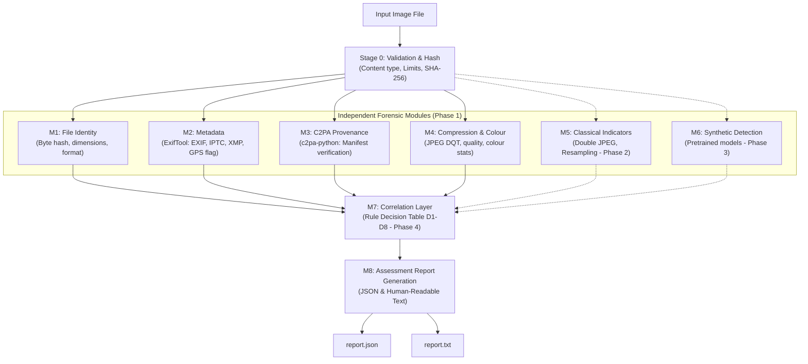

# 02. Project Architecture

## System Overview
The Single-Image Forensic Assessment architecture combines digital image provenance and metadata verification with pixel-level trace analysis. The system strictly adheres to the principle that evidence is typed and never averaged across orthogonal domains. It never outputs a binary "real" or "fake" verdict.

## Architectural Principles
1. **Module Independence**: Every module receives an immutable file path and configuration. No module reads or depends on another module's internal state.
2. **Unified Record Format**: All modules return the standard `EvidenceRecord` data structure containing typed observation, interpretation, and limitations.
3. **No Binary Labels**: Output states are strictly constrained to:
   - `indicated`
   - `not_indicated`
   - `inconclusive`
   - `verified`
   - `not_assessed`
4. **Fail-Safe Operation**: If a tool or external dependency fails or is unavailable, the module returns `failed` or `not_assessed` with a documented reason instead of crashing or guessing.
5. **Reproducibility**: Identical inputs with identical configurations yield byte-identical outputs, with the sole exception of the execution timestamp.
