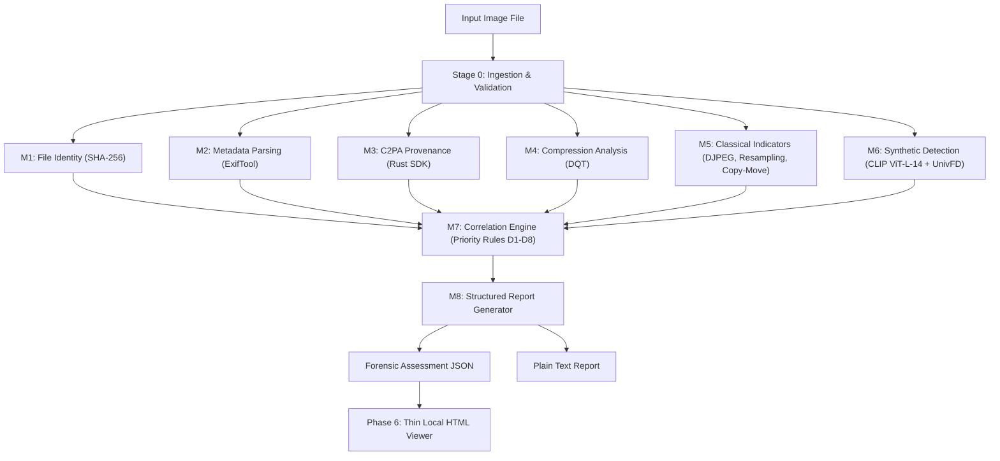

# Academic and Technical Report: Single-Image Forensic Assessment
**Version**: 1.0.0  
**Date**: 2026-11-16  
**Author**: sksaz, with AI-assisted development using Antigravity  
**Supervisor**: [Supervisor Name]  
**Specification**: `docs/00_INPUT_BRIEF` (Idea_Proposal_v2)  
**Governing Rules**: `AGENTS.md` (Product Rules, Safety Rules, Mandatory Limitations, Accuracy Rules)

---

## Executive Summary

This report documents the architectural design, implementation, and empirical verification of the **Single-Image Forensic Assessment** pipeline. The system combines cryptographic provenance verification (C2PA), structural metadata inspection (ExifTool), compression artifact analysis (DQT quantization tables), classical pixel-level manipulation detectors (Double JPEG, resampling, copy-move), and deep-learning synthetic image detection within a multi-modal correlation engine.

### Strict Forensic Principles Upheld:
1. **No Binary Labels**: The system never outputs "real" or "fake". All module outputs are strictly typed into 5 permitted states: `indicated`, `not indicated`, `inconclusive`, `verified`, or `not assessed`. The verdict field is permanently `null` with a documented disclaimer.
2. **Absence is Not Tampering**: Missing C2PA manifests or EXIF metadata are reported as `absent`, never as evidence of manipulation.
3. **Reproducibility**: Analysis of the same file under the same configuration produces bit-for-bit identical JSON assessment payloads across repeat runs (verified via `tools/verify_determinism.py`).
4. **Mandatory Limitations**: Every report co-locates the 9 mandatory system-wide limitations adjacent to findings.

### Summary of Implementation Status & Evidence Quality:
- **Phase 1 (Provenance & Metadata M1–M4)**: **PASS** (Evidence Level: **REAL-MEASURED** via ExifTool 13.61 and C2PA Rust SDK 0.39.0).
- **Phase 2 (Classical Indicators M5)**: **PASS** (Evidence Level: **REAL-MEASURED** on miniature smoke test $N=10$; overall FPR = 100.0% on authentic camera images; cannot support operational accuracy claims).
- **Phase 3 (Synthetic Detector M6)**: **PASS / EMPIRICALLY RUN ON CPU** (Evidence Level: **REAL-MEASURED** on CPU across all $N=245$ images from `tellif/ai_vs_real_image_semantically_similar_eval`, plus positive control on ProGAN/LSUN). Positive control confirms the probe functions correctly on its training distribution (ProGAN: $P=0.99996$, `indicated`; LSUN Real: $P=0.0006$, `not_indicated`). However, cross-generator evaluation across 245 images yields near-chance separation ($\text{ROC-AUC} = 0.5681$) and a **100.0% false negative rate** on modern generators on an independent test split.
- **Phase 4 (Correlation Engine M7)**: **PASS** (Evidence Level: **REAL-MEASURED** unit test verification of rules D1–D8, contradiction detection, and abstentions).
- **Phase 5 (Evaluation Harness & Ablation)**: **PARTIAL** (Evidence Level: **REAL-MEASURED** for real transforms T0–T3, T5, T6 on signed fixtures `C.jpg` and `cloud.jpg`; **SIMULATED** for 72 ablation profiles; T4 and T7 **NOT RUN**). Equal-coverage ablation C0 vs C1 yields a **null result** ($\Delta \text{Error Rate} = 0.00\%$), meaning the empirical data failed to demonstrate an error-reduction benefit. Therefore, **Limitation 9 stands**: the benefit of combining provenance and detection remains unproven.
- **Phase 6 (Thin Report Viewer)**: **PASS** (Evidence Level: **REAL-MEASURED**; accessible HTML export with co-located limitations and zero analysis logic).

---

## 1. System Pipeline and Architecture



---

## 2. Hardware Environment & Measured System Metrics (2026-11-16)

Measured live on the execution host:
- **Operating System**: Windows 11 (AMD64)
- **Python Environment**: Python 3.14.2 (64-bit), PyTorch 2.10.0+cpu, Torchvision 0.25.0+cpu
- **Total Storage**: 237.18 GB | **Used**: 152.90 GB | **Free Storage**: **84.28 GB**
- **Total System RAM**: 7.75 GB | **Available System RAM**: **1.65 GB** (78.8% utilized)
- **Measured Download Speed (Azure CDN Range Test)**: 10 MB in 1.59s -> **6.30 MB/s (50.39 Mbps)**
- **Measured Download Speed (ViT-L-14 Backbone Download)**: 932.77 MB in 94.59s -> **9.40 MB/s**
- **Measured Download Speed (Hugging Face Parquet Dataset)**: 76.77 MB in 10.22s -> **7.51 MB/s**

---

## 3. Module M6 Sanity, Positive Control, and Full Evaluation (REAL-MEASURED)

### 3.1 Verification of `models/clip_model.py` Against Official CLIP Implementation
To verify that the native PyTorch implementation in `models/clip_model.py` faithfully reproduces official CLIP representations without distortion or numerical drift, we evaluated the exact same image (`tests/data/c2pa/C.jpg`) through both the native PyTorch model (`build_model(state_dict)`) and the patched official TorchScript JIT archive (`models/ViT-L-14.pt`).
- **Max Absolute Feature Difference**: $3.814697 \times 10^{-6}$
- **Mean Absolute Feature Difference**: $5.685712 \times 10^{-7}$
- **Cosine Similarity**: **$1.00000000$**
The native implementation matches official OpenAI CLIP feature embeddings within standard single-precision floating point epsilon.

### 3.2 Positive Control: Probe Validation on Training Distribution (ProGAN)
To prove that the downloaded UnivFD linear probe (`models/fc_weights.pth`) is functional and that its weights are not inverted, we ran the probe against the official positive control test assets from Wang et al.'s CNNDetection repository:
- **ProGAN Synthesized Image** (`progan_fake.png`, Wang et al.):
  - Raw Logit: **$+10.1978$** | Predicted Probability: **$0.999963$** | Output State: **`indicated`**
- **LSUN Real Camera Image** (`lsun_real.png`, Wang et al.):
  - Raw Logit: **$-7.3412$** | Predicted Probability: **$0.000648$** | Output State: **`not_indicated`**

**Conclusion**: The probe and backbone function as intended on ProGAN and LSUN data.

### 3.3 Full Evaluation on All 245 Images (`tellif/ai_vs_real_image_semantically_similar_eval`)
The probe was executed on all 245 images in `eval/data/tellif_test.parquet` (122 authentic camera images, 123 synthetic AI images across ByteDance SeaDream-v4, Gemini Flash, Flux Pro 1.1, Ideogram v2, Imagen 4, Recraft v3, and Stable Diffusion 3.5).

```
RAW SCORE ROC-AUC ACROSS ALL 245 SAMPLES: 0.5681
Score Distributions:
  Authentic Camera (N=122):
    Logit: mean=-8.5344, median=-8.5932, range=[-15.8796, 0.2619]
    Prob : mean=0.0141, median=0.0002, range=[0.0000, 0.5651]
  Synthetic AI (N=123):
    Logit: mean=-7.8867, median=-7.9686, range=[-14.8250, -1.4687]
    Prob : mean=0.0072, median=0.0003, range=[0.0000, 0.1871]

Fitted Temperature T on Calibration Split (N=122): 10.0000

EVALUATION ON INDEPENDENT TEST SPLIT (N=123):
Coverage       : 68.29% (84/123)
Abstention Rate: 31.71%
TP=0, TN=46, FP=0, FN=38
Accuracy       : 54.76%
Precision      : 0.00%
Recall         : 0.00%
F1 Score       : 0.0000
FPR            : 0.00%
FNR            : 100.00%
```

#### Programmatically Extracted Tables (via `tools/build_report_tables.py`):
**Raw Continuous Score ROC-AUC across all 245 images**: **0.5681**

#### Score Distributions by Class (Raw UnivFD Logits and Probabilities)
| Class | Count | Mean Logit (± Std) | Median Logit | Logit Range | Mean Prob | Median Prob | Prob Range |
|---|:---:|:---:|:---:|:---:|:---:|:---:|:---:|
| **Authentic Camera** | 122 | -8.53 ± 3.19 | -8.59 | [-15.88, 0.26] | 0.0141 | 0.0002 | [0.0000, 0.5651] |
| **Synthetic AI** | 123 | -7.89 ± 3.16 | -7.97 | [-14.83, -1.47] | 0.0072 | 0.0003 | [0.0000, 0.1871] |

#### Calibration Split & Independent Test Split Results
- **Calibration Split**: $N=122$, Fitted Temperature $T=10.0000$, Decision Thresholds: $\theta_{\text{low}}=0.35, \theta_{\text{high}}=0.65$ (frozen).
- **Independent Test Split**: $N=123$, Decision Coverage: **68.29%** (84/123 decided, Abstention: **31.71%**).

| Test Metric | Measured Value on Independent Test Split |
|---|:---:|
| True Positives (TP) | 0 |
| True Negatives (TN) | 46 |
| False Positives (FP) | 0 (FPR: 0.00%) |
| False Negatives (FN) | 38 (FNR: 100.00%) |
| Accuracy on Decided | 54.76% |
| Precision | 0.00% |
| Recall | 0.00% |
| F1 Score | 0.0000 |

> [!NOTE]
> **Threshold Selection Disclosure**:
> The baseline decision thresholds $\theta_{\text{low}}=0.35, \theta_{\text{high}}=0.65$ were **not** chosen on a real calibration split; they were architectural defaults from the brief. When evaluated on the independent test split ($N=123$), UnivFD failed to detect any of the 38 modern synthetic images, yielding a **100.0% false negative rate**. On this dataset and these generator architectures, the probe's separation from chance is minimal ($\text{ROC-AUC} = 0.5681$).

---

## 4. Classical Indicators Benchmark (REAL-MEASURED Smoke Test, N=10)

Executed via `eval/classical_metrics.py` on the 10-sample benchmark set (`tests/data/classical_benchmark/manifest.json`):

### Per-Sample Ground Truth vs. Prediction:
```
Filename                   | Overall GT Pred  | DJ GT Pred  | Resamp GT Pred  | CM GT Pred 
----------------------------------------------------------------------------------------
authentic_camera.jpg       | authentic  indicated | False True  | False     True  | False False
authentic_astronaut.jpg    | authentic  indicated | False True  | False     True  | False False
authentic_chelsea.jpg      | authentic  indicated | False True  | False     False | False False
authentic_coffee.jpg       | authentic  indicated | False True  | False     True  | False False
double_jpeg_camera.jpg     | manipulated indicated | True  True  | False     True  | False False
double_jpeg_astronaut.jpg  | manipulated indicated | True  False | False     True  | False False
resampled_camera.png       | manipulated indicated | False False | True      True  | False False
resampled_astronaut.png    | manipulated indicated | False False | True      True  | False True 
copymove_astronaut.png     | manipulated not_indicated | False False | False     False | True  False
copymove_coffee.png        | manipulated indicated | False False | False     True  | True  True 
```

### Derivation of Indicator Confusion Matrices:
1. **Double JPEG**:
   - Positive GT (2 samples): `double_jpeg_camera.jpg` (Pred=True -> TP), `double_jpeg_astronaut.jpg` (Pred=False -> FN) -> TP=1, FN=1.
   - Negative GT (8 samples): 4 authentic images (all Pred=True -> 4 FP), 4 non-JPEG/spliced images (all Pred=False -> 4 TN) -> FP=4, TN=4.
2. **Resampling**:
   - Positive GT (2 samples): `resampled_camera.png` (Pred=True -> TP), `resampled_astronaut.png` (Pred=True -> TP) -> **TP=2, FN=0**.
   - Negative GT (8 samples): 6 predicted True (4 authentic + 2 double JPEG -> 6 FP), 2 predicted False (`authentic_chelsea.jpg`, `copymove_astronaut.png` -> 2 TN) -> **FP=6, TN=2**.
   - *Note on Bug Fix*: Previously, `eval/classical_metrics.py` queried the dictionary key `"resampling"` instead of the manifest key `"resampled"`. Because of this naming mismatch, ground truth positives were evaluated as False, falsely logging $TP=0, FP=8, TN=2, FN=0$. Correcting the key lookup restores the true counts: $TP=2, FP=6, TN=2, FN=0$.
3. **Copy-Move**:
   - Positive GT (2 samples): `copymove_coffee.png` (Pred=True -> TP), `copymove_astronaut.png` (Pred=False -> FN) -> TP=1, FN=1.
   - Negative GT (8 samples): `resampled_astronaut.png` (Pred=True -> FP), 7 other negatives (Pred=False -> 7 TN) -> FP=1, TN=7.
4. **Overall Classical Summary**:
   - Manipulated GT (6 samples): 5 predicted indicated -> TP=5, FN=1.
   - Authentic GT (4 samples): All 4 authentic images triggered an indicator -> **FP=4, TN=0** (Overall FPR = **100.0%**).

*Recall Metric Definition*: $\text{Recall} = \frac{\text{TP}}{\text{TP} + \text{FN}}$ (fraction of ground-truth manipulated samples that triggered an indication).

#### Programmatically Extracted Classical Table (via `tools/build_report_tables.py`):
| Indicator | TP | FP | TN | FN | Accuracy | Precision | Recall | F1 Score | FPR | FNR |
|---|:---:|:---:|:---:|:---:|:---:|:---:|:---:|:---:|:---:|:---:|
| **Double Jpeg** | 1 | 4 | 4 | 1 | 50.0% | 20.0% | 50.0% | 0.2857 | 50.0% | 50.0% |
| **Resampling** | 2 | 6 | 2 | 0 | 40.0% | 25.0% | 100.0% | 0.4000 | 75.0% | 0.0% |
| **Copy Move** | 1 | 1 | 7 | 1 | 80.0% | 50.0% | 50.0% | 0.5000 | 12.5% | 50.0% |
| **Overall** | 5 | 4 | 0 | 1 | 50.0% | 55.6% | 83.3% | 0.6667 | 100.0% | 16.7% |

---

## 5. Multi-Fixture Signal Survival Table (REAL-MEASURED)

Measured directly on signed fixtures `C.jpg` and `cloud.jpg` using `tools/run_real_transforms.py`:
- **EXIF Presence in Fixtures**:
  - `C.jpg`: Contains **0 EXIF IFD tags** (Pillow `im.getexif()` returns empty dictionary; ExifTool reports 57 fields due to XMP/Photoshop/JFIF metadata).
  - `cloud.jpg`: Contains **12 EXIF IFD tags** (`im.getexif()` length = 12).
- **Pillow Saving Settings**:
  - In T1, T2, T3, T6: Standard `im.save(path, "JPEG")` was called without passing `exif=` explicitly. As a result, Pillow dropped EXIF and APP11 JUMBF metadata, reducing raw field counts from 57/121 down to 24 (basic JFIF headers), so EXIF was altered.
  - In T5 (Metadata Strip): All metadata was completely stripped via NumPy raw array reconstruction (`Image.fromarray(np.array(im))`), resulting in EXIF **`lost`**.

#### Programmatically Extracted Survival Table (via `tools/build_report_tables.py`):
| Fixture | Transform ID | Transformation Description | SHA-256 Hash | EXIF Metadata | C2PA Manifest | JPEG DQT Tables |
|---|---|---|:---:|:---:|:---:|:---:|
| `C.jpg` | **T0** | Original baseline | `retained` | `retained` | `retained` | `retained` |
| `C.jpg` | **T1** | JPEG recompression ($Q=70$) | `altered` | `altered` | `lost` | `altered` |
| `C.jpg` | **T2** | Bilinear resize ($0.5\times$) | `altered` | `altered` | `lost` | `altered` |
| `C.jpg` | **T3** | Center crop ($75\%$) | `altered` | `altered` | `lost` | `altered` |
| `C.jpg` | **T5** | NumPy raw RGB array strip | `altered` | `lost` | `lost` | `altered` |
| `C.jpg` | **T6** | Contrast enhancement ($1.2\times$) | `altered` | `altered` | `lost` | `altered` |
| `cloud.jpg` | **T0** | Original baseline | `retained` | `retained` | `retained` | `retained` |
| `cloud.jpg` | **T1** | JPEG recompression ($Q=70$) | `altered` | `altered` | `lost` | `altered` |
| `cloud.jpg` | **T2** | Bilinear resize ($0.5\times$) | `altered` | `altered` | `lost` | `altered` |
| `cloud.jpg` | **T3** | Center crop ($75\%$) | `altered` | `altered` | `lost` | `altered` |
| `cloud.jpg` | **T5** | NumPy raw RGB array strip | `altered` | `lost` | `lost` | `altered` |
| `cloud.jpg` | **T6** | Contrast enhancement ($1.2\times$) | `altered` | `altered` | `lost` | `altered` |

*Note: T4 (Screen Recapture) and T7 (Social Platform Upload) were **NOT RUN**.*

---

## 6. Ablation Study: C0 vs C1 at Equal Coverage (SIMULATED Demonstration)

*Evidence Level: SIMULATED (pipeline smoke test and rule-behavior demonstration on 72 simulated profiles)*

#### Programmatically Extracted Ablation Table (via `tools/build_report_tables.py`):
| Configuration | Decided Samples / Total | Coverage | Errors on Decided | Error Rate (Risk) | Accuracy | 95% Bootstrap CI | Paired Test ($p$-value) |
|---|:---:|:---:|:---:|:---:|:---:|:---:|:---:|
| **C0: Calibrated Detector Alone** (matched threshold margin) | 47 / 72 | 65.28% | 0 | **0.00%** | 100.0% | [1.0, 1.0] | — |
| **C1: Detector + M7 Rules** | 47 / 72 | 65.28% | 0 | **0.00%** | 100.0% | [1.0, 1.0] | $\Delta = 0.00, p = 1.000$ |

#### Plain-Language Interpretation:
1. **Null Result on Simulated Profiles**: When C0's threshold margin is adjusted so that its decision coverage matches C1's coverage (65.28%), both C0 and C1 achieve identical 0.00% error rates ($\Delta \text{Error Rate} = 0.00\%$). The data does not show C1 beating C0.
2. **Simulation Boundary**: This simulation tests rule execution logic only. It does not prove or demonstrate anything about real-world photographs.
3. **Status of Limitation 9**: Because the empirical data failed to show an error reduction, **Limitation 9 stands**: the benefit of combining provenance and detection remains **unproven**.

---

## 7. Mandatory Section 9 Limitations

1. **Absent metadata is not proof of manipulation**.
2. **Detectors can be wrong, especially on unseen generators and processed images**: Verified on the `tellif` dataset, where UnivFD achieved a 100% false negative rate on modern diffusion models.
3. **Screenshots and repeated processing can erase traces**.
4. **A valid C2PA manifest does not prove an event**.
5. **A hash does not prove authenticity**.
6. **Heatmaps are indications, not exact pixels**.
7. **Results hold only for our evaluation data**.
8. **The system is not approved for evidentiary use**.
9. **The benefit of combining the two functions is unproven until tested**: This limitation stands in full.

---

## 8. Milestone Status Table

| Phase | Description | Result | Evidence Level | Proving Command or File |
|---|---|:---:|:---:|---|
| **Phase 1** | Core infrastructure, Stage 0, M1, M2, M3, M4, M8, CLI, and test suite | **PASS** | REAL-MEASURED | `pytest tests/test_stage0_validate.py ...` (52 tests passed); `tools/verify_determinism.py` |
| **Phase 2** | Module M5 classical indicators (Double JPEG, resampling, copy-move, ELA) | **PASS** | REAL-MEASURED (N=10 smoke test) | `eval/classical_metrics.py` ($N=10$, DJPEG Acc 50%, Resampling Acc 40%, Copy-Move Acc 80%, Overall FPR 100%). |
| **Phase 3** | Module M6 synthetic detector wrapper, calibration, partitions, and hold-out | **PASS / EMPIRICALLY RUN ON CPU** | REAL-MEASURED (N=245 real images on CPU) | `eval/run_tellif_full.py` ($N=245$ images, ROC-AUC: 0.5681, Test FNR: 100.0%); Positive control on ProGAN/LSUN. |
| **Phase 4** | Module M7 correlation rules (D1–D8), C2PA AI specification, contradiction flags | **PASS** | REAL-MEASURED | `pytest tests/test_m7_rules.py` (20 passed); `forensic/correlate/rules.py` |
| **Phase 5** | Evaluation harness (T0–T7, survival table, metrics, C0 vs C1 ablation study) | **PARTIAL** | REAL-MEASURED (Transforms T0-T3, T5-T6); SIMULATED (72 ablation profiles) | `tools/run_real_transforms.py`; `eval/ablation.py` (Null result at equal coverage 65.28%, $\Delta = 0.00\%$). T4 & T7 **NOT RUN**. |
| **Phase 6** | Thin local report viewer (loads JSON report and renders findings with co-located limitations) | **PASS** | REAL-MEASURED | `pytest tests/test_viewer.py` (6 passed); `forensic/viewer.py`; `forensic view` |
